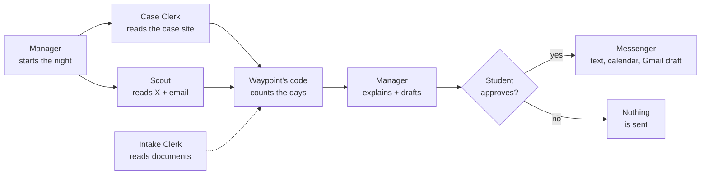

<div align="center">

# waypoint

<p><b>1st place · Best Student Use Case · Berkeley × Stanford Grok Bot Hackathon, November 2026</b></p>
### Your visa deadlines, watched for you.

**One missed deadline can end an international student's time in the US. Waypoint puts a team of Grok Bots on watch: they track every visa deadline overnight and tell the student before it's too late.**

[**Try the live demo →**](https://waypoint-5o4r.onrender.com)

<sub>Berkeley × Stanford Grok Bot Hackathon · Track 02: Best Student Use Case · Ria Sethi, Vihaan Bussa, Abhi Mokkapati, Bhargav Nemani</sub>

</div>

<br>

> [!IMPORTANT]
> **For most students, a missed deadline costs points. For an international student, it can cost the right to stay in the country.**
> Waypoint does the checking every night, so no student finds out too late.

<br>

<div align="center">

| **1,146,163** | **335,785** | **90 days** | **6 → 1** |
|:---:|:---:|:---:|:---:|
| international students in the US this year | of them on OPT, where the clock is strictest | of unemployment allowed on OPT before status is at risk | weekly chores replaced by one text |

<sub>Student counts: IIE Open Doors 2026 (2025/26 academic year).</sub>

</div>

---

## Inspiration

We've watched our own friends live with this. An international student does unpaid admin every week: they open the government case-status site to see if anything moved, scan X, forums and school emails for rule changes, dig dates out of PDFs, count unemployment days by hand, and write to HR or the international office. None of it has an alert or an API.

> *"If I mess one thing up, I'm gonna be deported."*
> — an international student on OPT, interviewed by the East-West Center

And it isn't one set of rules. Every visa runs on its own clock, and the rules change the moment a student's status does. On OPT you can be unemployed for 90 days. Lose an H-1B job and you get 60. Most students learn these numbers the hard way.

## What it does

Think of Waypoint as a small office that works while the student sleeps.

1. **Overnight, a Manager Bot wakes up the team.** One worker reads the case-status website. Another searches X and official pages for rule changes and reads the student's email for dates.
2. **Waypoint's own code counts the days.** The AI never does date math. Each deadline is marked **Act now** (14 days or fewer), **Watch** (45 or fewer) or **Clear**.
3. **The student wakes up to one page,** the Brief: what needs them now, every deadline grouped by urgency, and any emails already drafted for them.
4. **The student approves anything sent to another person** with one click. Texts and calendar events go only to the student, so they need no approval.



### The team: one manager, four workers, one goal

| Bot | Role | What it does | When it runs | Template |
|---|---|---|---|---|
| **Manager** | Manager | Owns the one nightly schedule. Starts the workers, waits for them, has Waypoint count the deadlines, drafts emails and holds them for the student's approval, then hands off to Messenger | 2:00 AM every night, and on "Check now" | [Add to Grok Bot](https://x.ai/bot/jYDsF_XLTmGDAM1cmxTf-) |
| **Case Clerk** | Worker | Opens the case-status site like a person would and records the status word for word. It only reads | When the Manager starts the night | [Add to Grok Bot](https://x.ai/bot/TuGI6owtPK-_2rvVhnCqi) |
| **Scout** | Worker | Searches X and official pages (USCIS, State Department, Federal Register) for rule changes that apply to the student, finds dates in mail from USCIS, the school and the employer, and watches the student's school | When the Manager starts the night | [Add to Grok Bot](https://x.ai/bot/rEMFD4TMgX8v2vJ_xv2jB) |
| **Messenger** | Worker | Texts the student, keeps one calendar event per deadline, and saves approved emails as Gmail drafts | After the Manager hands off, and after an approval | [Add to Grok Bot](https://x.ai/bot/EuYNcmgfkyJfJnOAURC9v) |
| **Intake Clerk** | Worker | Reads a photo or PDF of an immigration document (I-20, EAD card, I-797, I-94, DS-2019, passport) and says which field each value goes in | When the student sends a document | [Add to Grok Bot](https://x.ai/bot/GWvDg0sSZiCdx1GXucMiv) |

No template contains a key. Each one's first-run setup asks the new owner for their own key and points them to the Waypoint connector at `https://waypoint-5o4r.onrender.com/mcp`.

### Six weekly chores, replaced

| Weekly chore, by hand | Replaced by |
|---|---|
| Check case status on the government site | Case Clerk |
| Look for rule changes on X, forums and school emails | Scout |
| Find dates in notices and emails | Scout, Intake Clerk |
| Count days left, including unemployment days | Waypoint's code, explained by the Manager |
| Write to HR or the international office | Manager (drafts only) |
| Put deadlines in a calendar and get reminded | Messenger |

### Every visa runs on its own clock

Each visa type is a **rule pack**: rows of deadlines, limits and official sources. A new visa type is new rows, not new code.

| Visa | A rule students miss | In the demo |
|---|---|---|
| F-1 | Apply for OPT from 90 days before your program ends to 60 days after | Yes |
| OPT / STEM OPT | 90 days of unemployment allowed, 150 in total on STEM OPT | Yes |
| H-1B | Up to 60 days to find a new sponsor, change status or leave after a layoff | Yes |
| J-1, O-1, L-1, green card | Grace periods, time limits and filing windows | Written in code, not yet in the demo |

### Safety rules, enforced by the server

> [!NOTE]
> These live in Waypoint's server, so no Bot can talk its way around them.
>
> - **No Bot does date math.** The tools refuse a day count. Days left, risk and school scores only come out of Waypoint's code.
> - **Nothing reaches another person without approval.** A Bot can only save a draft, and the server refuses to mark an email delivered unless the student approved it.
> - **A post on X is never enough.** A rule change needs an official source, and Scout must list the X searches it ran or its run is rejected.
> - **No ID numbers in a text.** Texts with a receipt number, or over 300 characters, are refused. At most 6 texts a day.
> - **Waypoint writes the texts.** A Bot only picks the kind of message and the deadline, so the numbers are always right.
> - **Not legal advice.** Waypoint organizes and alerts, and every rule links to its official source.

## How we built it

| Piece | What it is |
|---|---|
| **The five Bots** | Grok Bots, each set up with one first message stating its job, where it looks, what it must never do, and the team's goal (text in `bots/`) |
| **The connector** | An MCP server at `/mcp` that gives the Bots 21 tools to read the Brief and save what they find. The safety rules live in the tools (`lib/bot-tools.js`) |
| **The rules engine** | One plain function turns a student's dates into deadlines. Every rule is a row: anchor date, offset, thresholds, reason and official source (`public/js/rules.js`, `public/js/clocks.js`) |
| **School tracking** | Scout collects raw facts about schools (advisor ratio, international office, emergency funds, student sentiment); fixed code turns them into a score (`public/js/schools.js`) |
| **The website** | One Node 22 program with no dependencies and plain JavaScript pages, hosted on Render. Data is saved to Upstash Redis so it survives the free host's sleeps |
| **Texts** | Twilio, called from the server |
| **Tests** | `node --test`, run on every push by GitHub Actions: day counts, rule packs and the whole server end to end |

## How Grok Bot helped build it

Grok Bot is both how Waypoint runs and how we proved it works.

- **The Bots are the product.** All five are Grok Bots, shared as templates. Case Clerk uses Grok Bot's own computer to read a case-status site that has no API, Scout uses X search and Gmail, Intake Clerk uses vision to read documents, and Messenger uses the Calendar and Gmail connectors.
- **Grok Bot ran the system end to end.** In the live demo's activity log, the Manager's nightly run starts Case Clerk, Scout and Messenger, updates the case status and records the HR email as a Gmail draft. Scout's run lists its X searches and the 112 posts it read.
- **Building the team in Grok Bot shaped the design.** Running six Bots on six separate timers showed they weren't coordinating, which is why the Manager now owns one schedule and every handoff. Watching runs return "no relevant changes" with no proof led to the rule that Scout must list its searches.

## Challenges we ran into

- **Bots get dates wrong.** So no Bot counts days: plain code does, and the tools refuse a day count.
- **Proving a Bot actually looked.** "No relevant changes" could mean it never searched, so Scout now has to list its X searches or the run is rejected.
- **Six Bots on six timers was not a team.** Nothing coordinated them, and the rule-change check ran hours after deadlines were counted. The Manager now owns one schedule and every handoff.
- **Free hosting forgets.** The host wipes its disk when it sleeps, so accounts and Bot runs are saved to a database on every change.
- **Twilio trial accounts refuse custom wording.** Waypoint falls back to Twilio's sample texts and records the real line in Activity.

## Accomplishments we're proud of

- A real loop from a status change on the case-status site to a deadline on the student's Brief, with every number traceable to a rule and an official source
- An approval step enforced by the server, not by a Bot's good behavior
- Live text messages to a real phone, with the wording written by Waypoint rather than the AI
- A Manager that coordinates four workers on one schedule

## What we learned

- Dates are the riskiest thing to hand an AI, so the AI reads and drafts while plain code counts.
- Safety rules hold only when the server enforces them, not when a Bot's instructions ask nicely.
- One owner of the schedule beats several Bots on their own timers.

## What's next

- **More visa types.** Rule packs for J-1, O-1, L-1 and the green-card path are already in the code; next is testing them with real students.
- **School tracking.** More schools and more signals for ranking, plus notices from each student's own school.
- **Document upload.** Intake Clerk reads documents today when sent one in Grok Bot; uploading from the site and approving by text come next.
- **Real accounts.** Password reset and email verification.

## How to run it

**Fastest:** open [waypoint-5o4r.onrender.com](https://waypoint-5o4r.onrender.com) and press **Show me the demo**. It has two sample students, Priya (F-1 on OPT) and Wei (H-1B). The server sleeps when idle, so the first load can take up to a minute.

**The 60-second tour**
1. Press **Show me the demo**.
2. Open `/portal/admin/` and change the case status to "Request for Evidence Was Sent" with a response date.
3. Press **Run a simulated Case Clerk check**. Back on the Brief, a new deadline appears under Watch with its day count.
4. Approve the drafted email. It becomes a Gmail draft, ready to send.
5. Switch to Wei Chen to see the same Bots follow a graduate on H-1B.

**Locally** (Node 22 or newer, nothing to install):

```bash
node server.js        # then open http://localhost:4173
node --test           # run the tests
```

To let a Bot's computer reach your copy, run it on a public https address (a Bot cannot reach localhost):

```bash
HOST=0.0.0.0 PORT=8080 node server.js
```

Optional settings: `UPSTASH_REDIS_REST_URL` and `UPSTASH_REDIS_REST_TOKEN` keep data across restarts; `TWILIO_ACCOUNT_SID`, `TWILIO_AUTH_TOKEN` and `TWILIO_FROM_NUMBER` turn on texts. Hosting, connecting real Bots, the connector's tools and the API are in [`docs/TECHNICAL.md`](docs/TECHNICAL.md).

### What is not built yet

- The Bots live in your own Grok Bot app, not in this repository. Until they are connected, the Brief shows sample runs and a simulated "Check now".
- Document upload from the site, and approve-by-text.
- Messenger's calendar and Gmail work happens inside Grok Bot; the site offers "Add to Google Calendar" and a pre-filled Gmail window as a fallback.
- Password reset and email verification.

---

<div align="center">
<sub>Waypoint organizes, alerts and drafts. It is not legal advice. The demo's case-status site is a mock and its students are made up, to protect real students' privacy.</sub>
</div>
